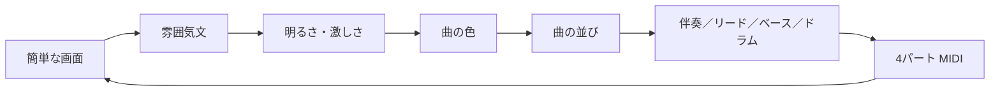

# 中間発表スライド原稿・貼り付け用

> 各「スライド N」のタイトル・箇条書き・表・図をそのままスライドに転写する。  
> 発表: 2026-08-21 / 8分

| 節 | 時間 |
|---|---|
| A, B | 1分 |
| C | 2分 |
| D, E, F | 4分 |
| G | 0.5分 |
| H, I | 0.5分 |

---

## スライド 1 — A. タイトル

### タイトル
感情条件付きギターMIDI生成

- 中間発表 2026-08-21
---

## スライド 2 — B. はじめに / 背景

### タイトル
研究分野と問題

- 出発点: DAWで直せるMIDIを、音楽作成者の下書きにする
- 既存: 雰囲気文→編集可能MIDIは、ピアノ等で多い
- 穴: 同じラインをギターバンド（伴奏／リード／ベース／ドラム）に持っていくとどうなるかが整理されていない
- 最終形: 簡単な画面に雰囲気文を入れ、4パートMIDIを受け取れる
---

## スライド 3 — C. 関連研究 1/2

### タイトル
コミュニティの取り組みと最先端

| 系統 | 最先端 | コミュニティの取り組み |
|---|---|---|
| 文→完成音 | Suno、Udio | 雰囲気文から完成音を出す |
| 商用MIDI | AIVA | 雰囲気文から編集可能MIDIを出す |
| 研究の文→MIDI | MuseCoco、text2midi | 自由文や属性から多トラックMIDIを出す |
| 構成・短尺 | Whole-Song、ViTex | 全曲構成、8小節の多トラックを出す |

---

## スライド 4 — C. 関連研究 2/2

### タイトル
既存の良い点と悪い点

| 既存 | 良い点 | 悪い点 |
|---|---|---|
| Suno、Udio | 雰囲気文から完成音が速い | ノート単位で直すMIDI骨格ではない |
| AIVA | DAWで直せるMIDIが出る | 管弦楽・シネマ寄り。ギターバンドの役割が中心でない |
| MuseCoco、text2midi | 文から多トラックMIDIが出る | ギターの役割や区間のドラム型が主眼でない |
| Whole-Song、ViTex | 構成や短い区間の表現が強い | ピアノ伴奏中心、またはコード指定が前提 |

- 本研究: このラインをギターバンドに持っていく
- 足すもの: 役割制約（衝突回避、キックに合わせたベース、区間のドラム型）
---

## スライド 5 — D. 研究目的

### タイトル
研究目的。既存を拡張する

- 利用上の利点: DAWで直せる4パートMIDIを、音楽作成者の下書きにする
- 研究の問い: ピアノ寄りの生成ラインをギターバンドに持っていくとどうなるか
- やること: 途中層（進行・曲の並び・ドラム型）と、ギターの役割制約を載せる
- 出すもの: 明るさ・激しさ、進行、曲の並び、4パートMIDI、簡単な画面
- スコープ外: 音声波形の生成
---

## スライド 6 — E. 主なアイデア + 設計 1/2

### タイトル
全体の流れ

- 現状の入口: コマンド。最終形: 簡単な画面
- 生成順: 伴奏 → リード → ドラム → ベース
- リードは伴奏とぶつからない。ベースはキック位置にルートを合わせる
---

## スライド 7 — E. 主なアイデア + 設計 2/2

### タイトル
曲の色・並びと役割

| レイヤ | 決めること |
|---|---|
| 曲の色 | 主題の進行・キー・BPM |
| 曲の並び | 曲の型、区間の進行、区間のドラム型 |

- 演奏は8小節単位。長い曲は曲の並びでつなぐ
- 現状: 曲の型とドラム型はルール。今後は学習
- 学習: 合成進行データ中心。各パートは完了済み
---

## スライド 8 — F. 予備結果

### タイトル
実装の到達点

| 項目 | 状態 |
|---|---|
| 文 → 明るさ・激しさ → 曲の色・並び → 4パート | 実装済み |
| 各パートの学習 | 完了 |
| ギターの役割制約 | 反映済み |
| 簡単な画面 | 未着手 |
| ギター下書きとしての評価 | 未実施 |

- 例: 「しんみりとした曲」→ 構成付き4パートMIDI
- 限界: 下書きとして使えるかの本判断はこれから
---

## スライド 9 — G. 評価計画

### タイトル
評価計画

機械評価
生成したMIDIを機械で毎回測る
調内の音の割合、空拍の割合、同時に鳴っている音の数、調が途中で崩れていないか
低いものは聴感の前に除外する

聴取
Melodiousness: 旋律として音楽的・調和的に聞こえるか
Rhythmicity: 拍・リズムにまとまりがあるか
Structureness: 反復や展開など、構造的なまとまりがあるか
Correctness: 突然の無音など、技術的破綻が少ないか
Overall: 総合的に、この曲の聴感品質に満足できるか
5点。定義文を固定して聞く

下書きとして使えるか
埋まっていないか
キックとベースが噛んでいるか
区間の切り替わりが分かるか
DAWで直して使えそうか

比較
同じ雰囲気文で、既存のMIDI生成と並べて聞く
同じ文で、役割制約ありとなしも並べて聞く
---

## スライド 10 — H. スケジュール

### タイトル
中間発表後のスケジュール

| 時期 | 内容 |
|---|---|
| 〜8月末 | 機械指標の記録。代表MIDIの整理 |
| 9月 | 発音の再学習。聴取1ラウンド。曲MIDI・奏法MIDIの依頼 |
| 10月 | 比較表。MIDI受領。足りない点の洗い出し |
| 11月 | 受領MIDIで演奏を改善。曲の並びと骨格の修正 |
| 12〜1月 | 再評価。簡単な画面。公開用のまとめ。卒論 |
| 2月 | 画面から生成できるデモ |

- 残る本線: MIDIを作ってもらう → それで演奏を改善する → 骨格を直す
- 直近4週間: 機械指標、再学習、聴取、MIDI依頼を出す
---

## スライド 11 — I. 結論

### タイトル
結論

- 出発点: DAWで直せるMIDIを、音楽作成者の下書きにする
- 問い: ピアノ等の生成ラインをギターバンドに持っていくとどうなるか
- 現状: 生成と学習は完了。評価と簡単な画面はこれから
- 最終形: 簡単な画面に雰囲気文を入れ、4パートMIDIを生成できる
---

## 出典。スライド末尾に小さく

- MuseCoco, Lu et al. 2023 — https://arxiv.org/abs/2306.00110
- text2midi, Bhandari et al., AAAI 2025 — https://doi.org/10.1609/aaai.v39i22.34516
- Whole-Song Cascaded Diffusion, Wang et al., ICLR 2024 — https://openreview.net/forum?id=sn7CYWyavh
- ViTex, Yi et al., ICASSP 2026 — https://doi.org/10.1109/icassp55912.2026.11463443
- Suno — https://suno.com
- Udio — https://www.udio.com
- AIVA — https://www.aiva.ai
- MusPy metrics — https://muspy.readthedocs.io/en/stable/doc/metrics.html
- Yang & Lerch 2020 — https://doi.org/10.1007/s00521-018-3849-7
- Chu et al., CIKM 2022 — https://doi.org/10.1145/3511808.3557235
